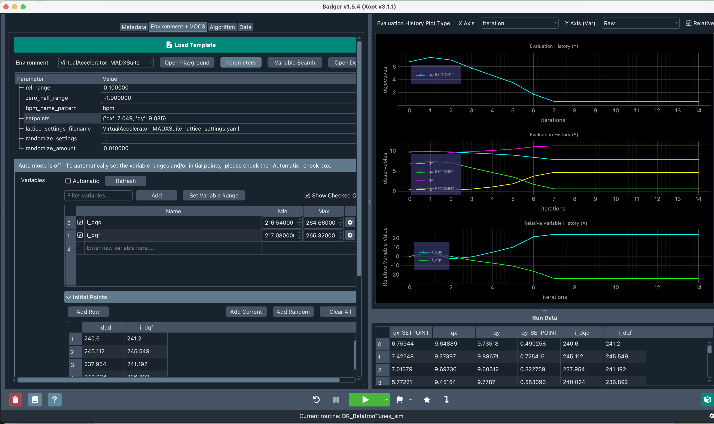
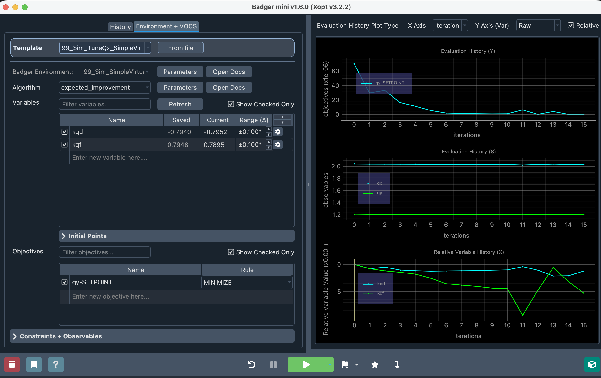

# FermiBadgerPlugins - Use Badger to run Xopt at Fermilab

This repository contains plugins and configurations for using [Badger](https://github.com/xopt-org/Badger) (the Bayesian optimization GUI frontend) with [Xopt](https://github.com/xopt-org/Xopt) at Fermilab. It includes:

- **Tuning templates** - Pre-configured optimization setups for various accelerator tuning tasks
- **VirtualAccelerator tuning** - using lattice files of the physical machines and toy simulations
- **Test script** - `tests/test-quick-start.sh` to verify your installation

<table>
<tr>
<td valign="top">

## Contents

- [Quick Start](#quick-start)
- [safe-badger: revert and crash safety](#safe-badger-revert-and-crash-safety)
- [Environment Setup Details](#environment-setup-details)
- [First-Time GUI Setup](#first-time-gui-setup)
- [Using the VirtualAccelerator Environment Plugins](#using-the-virtualaccelerator-environment-plugins)
- [Troubleshooting](#troubleshooting)
- [Repository Structure](#repository-structure)
- [For Developers](#for-developers)
- [Related Documentation](#related-documentation)

</td>
<td align="center" width="340">

<code>badger -g</code><br>


<code>badger -mini</code><br>


</td>
</tr>
</table>

## Quick Start

[↑ Back to top](#contents)

### 1. Clone this repository

```bash
git clone git@github.com:fermi-ad/FermiBadgerPlugins.git
cd FermiBadgerPlugins
```

### 2. Run the bootstrap script

```bash
./bootstrap.sh
```

This installs [pixi](https://pixi.sh) if it's not already on your `PATH`, resolves and builds the environment from `pixi.toml`, applies the Badger patches, writes `config.local.yaml`, and verifies the plugin is discoverable — see [Apply patches and configure by hand](#apply-patches-and-configure-by-hand) for what it does under the hood:

1. Installs pixi, if missing.
2. `pixi install` builds the environment from `pixi.toml`/`pixi.lock`. The default environment includes `acsys` from FNAL's internal pip repository, so it needs the FNAL network (on-site or VPN) — this matches the MCR host. Off that network, use `./bootstrap.sh --offsite` instead, which skips `acsys`.
3. Applies the Badger patches to that environment.
4. Writes `config.local.yaml` with this clone's paths — it works no matter where you cloned the repo, `/tmp` included. Your archive and logbook directories default to `~/BadgerArchive` and `~/BadgerLogs`; press Enter to accept or type your own.
5. Verifies that Badger can discover the plugins.

It is safe to re-run: patches already applied are detected and skipped.

```bash
./bootstrap.sh --help     # options
./bootstrap.sh --yes      # take every default, no prompts
./bootstrap.sh --offsite  # skip acsys; no FNAL network needed, for off-site dev work
```

### 3. Launch

Try it safely first, in the compact GUI under **safe-badger**, which puts back every device the session changed if Badger is interrupted (see [safe-badger](#safe-badger-revert-and-crash-safety)). This template writes only ACNET scratch/test devices (`G:AMANDA`, `Z:CUBE_X/Y/Z`) and needs a Kerberos ticket; it is a demonstration run from a decoy to the global minimum:

```bash
pixi run safe-badger mini -t development/ZZ_PacsysTesting.yaml
```

With no control network at all, a simulation:

```bash
pixi run badger -mini -cf config.local.yaml -t simulation/TuneQx_SimpleVirtualAccelerator.yaml
```

Operations (writes real Linac devices; always under safe-badger):

```bash
pixi run safe-badger mini -t 01_Linac_RIL_tuning.yaml
pixi run safe-badger g -t 01_Linac_RIL_tuning.yaml      # the full GUI
```

Template names are relative to `tuning_templates/`. The full GUI without a template: `pixi run safe-badger g` (or `pixi run badger -g -cf config.local.yaml`).

Off-site, on the `offsite` environment, add `-e offsite`: `pixi run -e offsite badger -g -cf config.local.yaml`.

`config.local.yaml` is gitignored, so the tracked `config.yaml` stays a clean template and `git pull` never conflicts with your local paths.

---

## safe-badger: revert and crash safety

[↑ Back to top](#contents)

```bash
pixi run safe-badger mini -t 01_Linac_RIL_tuning.yaml   # launch -mini, protected
pixi run safe-badger g -t 01_Linac_RIL_tuning.yaml      # launch the full GUI, protected
pixi run safe-badger diff logs/snapshots/<file>.json     # what differs from a snapshot now
pixi run safe-badger restore logs/snapshots/<file>.json  # write a snapshot back
```

**What it does.** Each time either GUI loads a template, and again when a run starts (Go), it records the live setting of every device the environment can write, checked in the variable table or not. A device keeps the value it had the first time it was recorded in the session. From then on:

- **Revert** (action bar, next to Reset environment) shows the devices that moved, in a fixed-width `Device / Now / Startup` table with the snapshot's age, and writes the startup values back. The session continues.
- **Closing the window** asks **Keep / Revert / Cancel** when anything differs.
- If Badger ends **without that answer** (a crash, `kill -9`, Ctrl-C, closing the terminal) **within 2 hours** of the first template load, safe-badger stops Badger and any run process it left behind, then restores every device automatically. The status bar shows the cut-off time after each template load, e.g. `...devices saved; automatic restore if interrupted until 15:05`.

**How it is built.** Three pieces:

| Piece | Where | What it does |
|---|---|---|
| Snapshot library | `plugins/settings_snapshot.py` | Chooses the devices (skips `mult:*` knobs and `-SETPOINT` observables; a `READ,SET` pair records `SET`; `nosettings` / simulation environments record nothing). Reads `<dev>.SETTING@I` with `pacsys.get_many`, saves `logs/snapshots/<time>-<pid>.json` atomically, and restores by `pacsys.dpm(role=...).write_many` of the raw `.SETTING` values, one session per settings role, verifying with up to 3 passes. Standard library + pacsys only; Badger's environment code is never involved. |
| GUI hooks | `patches/badger-1.6.0-revert-settings.patch` | One mixin, `badger/gui/components/settings_guard.py`, used by both home pages: captures on every template load and at Go, adds the Revert button, and asks Keep / Revert / Cancel in each window's `closeEvent`. Records the answer in the snapshot file. |
| Launcher | `safe_badger.py` (pixi task `safe-badger`) | Starts `badger -mini` (or `-g`) `-cf config.local.yaml ...` in a **new process session**, so one `killpg` stops the GUI and its run worker together. Catches SIGINT/SIGTERM/SIGHUP. When Badger exits or a signal arrives, it terminates the group (TERM, then KILL after 5 s) and, if the snapshot holds no Keep/Revert answer, restores it. Logs to `logs/safe-badger.log`. |

**Things to know.**

- Restores need a **valid Kerberos ticket**. safe-badger warns at start if there isn't one, and on any failed restore logs the exact `pixi run safe-badger restore <file>` command.
- If safe-badger itself is killed or the host goes down, the next `safe-badger mini` or `g` does **not** restore the old snapshot, since the machine may have been retuned since. It renames the file `*.stale` and logs the restore command.
- Plain `badger -mini` / `badger -g` still have Revert and the close question, but no automatic restore.
- After 2 hours the automatic restore stops: someone may have retuned by hand since. An undecided snapshot past that point is renamed `*.expired` and the restore command is logged. Revert and the close question still work at any age. The limit is `MAX_AUTO_RESTORE_HOURS` in `plugins/settings_snapshot.py`.

Full technical description (processes, snapshot file format, every ending, tests): **[docs/safe-badger.md](docs/safe-badger.md)**.

---

## Environment Setup Details

[↑ Back to top](#contents)

### Pixi Environment (`pixi.toml` / `pixi.lock`)

`pixi.toml` defines the environment with:

- **Python**: 3.12.1
- **Badger**: 1.6.0
- **Xopt**: pulled in transitively by `badger-opt=1.6.0` (currently 3.2.2)
- **XSuite packages**: xtrack, xobjects, xfields, xcoll, xsuite
- **cpymad** for MADX
- **pacsys** (FNAL Accelerator Control System)

`acsys` (also FNAL Accelerator Control System, but requiring the FNAL network to install) is part of the default environment, matching the MCR host. Off-site dev work uses the `offsite` environment instead, which skips it. `pixi.lock` pins exact versions for `osx-arm64` and `linux-64`; regenerate it with `pixi install` (or `pixi install -e offsite`) after editing `pixi.toml`, and commit the updated lock file.

**Legacy conda path (frozen 2026-10-23).** pixi is the only maintained way to install. `environment.yml` (the `FermiBadger_env` conda environment, `acsys` unconditional) and `./setup.sh` stay in the repo, unmaintained: they get no new patches, so a conda install lags behind pixi from here on. Use them only to keep an existing conda install running until it is retired; `tests/test-quick-start-conda.sh` checks that path.

### Why Patches Are Required

Badger 1.6.0 has several pydantic rules that affect template loading and the `-mini` variable table for the VirtualAccelerator plugins (which dynamically build lists of variables & observables from lattice files). See [`patches/README.md`](patches/README.md) for the full list of issues and which patch fixes each one.

### Apply patches and configure by hand

`bootstrap.sh` does this for you (Quick Start step 2). Do it by hand only for a non-pixi Badger install, or to see the mechanics.

`bootstrap.sh` (via `pixi run setup`) applies the Badger patches to your pixi environment — fixing template-loading errors, `turbo_controller: null` handling, and the `-mini` variable table — and writes `config.local.yaml` with `BADGER_PLUGIN_ROOT`, `BADGER_TEMPLATE_ROOT`, `BADGER_LOG_DIRECTORY` pointed at this clone, plus your chosen archive/logbook directories.

For the patches, see [`patches/README.md`](patches/README.md) for `patch`/`git apply` walkthroughs. For the config, copy `config.yaml` to `config.local.yaml` (gitignored) and set these to absolute paths, creating each directory if it doesn't exist:

- `BADGER_PLUGIN_ROOT` - the `plugins` directory of this repo
- `BADGER_TEMPLATE_ROOT` - the `tuning_templates` directory of this repo
- `BADGER_LOG_DIRECTORY` - the `logs` directory of this repo
- `BADGER_ARCHIVE_ROOT` and `BADGER_LOGBOOK_ROOT` - where run data and logs go (can be the same, and need not be inside the repo)

### Verifying your installation

Run the test script to verify everything is set up correctly:

```bash
./tests/test-quick-start.sh
```

This script:
- Clones a fresh copy of the repository to `/tmp/FermiBadgerPluginsTEST`
- Runs `./bootstrap.sh --yes` there, in its own `.pixi/` environment
- Verifies the plugin is discoverable by Badger

**Note:** The test uses a separate clone to avoid touching your own `config.local.yaml` or `.pixi/` environment.

---

## First-Time GUI Setup

[↑ Back to top](#contents)

Point Badger at a different `plugins`/`tuning_templates`/archive/logbook location later — a second clone, a shared archive drive — without rebuilding the pixi environment or reapplying patches:

```bash
pixi run setup -- --config
```

This only rewrites `config.local.yaml`; it asks the same archive/logbook questions as a full setup but skips patching.

### Loading a tuning template

Use `File > Open Template` and choose one from `tuning_templates/`. Badger loads the matching Environment and Interface automatically, along with the template's preset variables, objectives, and algorithm settings.

- Top level of `tuning_templates/` holds the operations-ready physical-machine templates (currently `01_Linac_RIL_tuning.yaml`). These, plus your own saved ones (below), are the ones the `-mini` GUI's template dropdown lists; the full GUI's file dialog can browse into the subdirectories.
- `tuning_templates/saved/` - templates saved with `-mini`'s **Save as...** button (Tuning Task box). Gitignored, so each installation keeps its own and `git pull` never touches them; the dropdown lists them as `saved/<name>`. Saving over an operations template is refused.
- `tuning_templates/development/` - physical-machine templates still being worked on. They require valid Kerberos credentials and the matching settings role.
- `tuning_templates/simulation/` - simulation templates, no credentials needed:
  - `TuneQx_SimpleVirtualAccelerator.yaml` - quick-start example (toy simulated storage ring)
  - `DR_BetatronTunes_sim_VirtualAccelerator_MADXSuite.yaml` - Delivery Ring tune optimization (MAD-X simulation)

---

## Using the VirtualAccelerator Environment Plugins

[↑ Back to top](#contents)

The 99_Sim_VirtualAccelerator_MADXSuite environment:

1. Loads a MAD-X lattice file (specified by `lattice_filename` parameter)
2. Automatically deduces variables (knobs, element attributes) and observables (optics, BPM reads) from element names
3. Uses XSuite for fast re-simulation when variables are changed
4. Supports MAD-X deferred expressions that are re-evaluated on each iteration

### Lattice Files

Lattice files are stored in `sim_configs/`. 

### Configuration Parameters

This simulation-tuning environment accepts these parameters in its tuning templates:

| Parameter | Description |
|-----------|-------------|
| `lattice_filename` | Path to MAD-X lattice file (relative to repo root) |
| `sequence_name` | MAD-X sequence name to use |
| `sequence_name_matched` | Matched sequence name for tuning |
| `rel_range` | Range for auto-deducing variable bounds (default: 0.1) |
| `zero_half_range` | Half-range for zero-valued variables (default: 0.1) |

---

## Troubleshooting

[↑ Back to top](#contents)

### FNAL Network Required (default pixi environment)

The `acsys` package is hosted on FNAL's internal pip repository (`https://www-bd.fnal.gov/pip3`). You must be on the FNAL network (on-site or VPN) to install it. The `offsite` pixi environment (`pixi install -e offsite` / `./bootstrap.sh --offsite`) doesn't need it.

**Error if off-network**:
```
error: Because acsys was not found in the package registry and you require acsys==0.12.8, we can conclude that your requirements are unsatisfiable.
```

### libGL.so.1 Missing

On headless systems or some Docker configurations, Badger may fail with:
```
ImportError: libGL.so.1: cannot open shared object file
```

**Fix**:
```bash
pixi add mesa-libgl-cos7-x86_64
# or on Ubuntu/Debian:
sudo apt-get install libgl1-mesa-glx
```

### OMP_NUM_THREADS on EAF

When running on the EAF (Experimental Accelerator Facility), set:
```bash
export OMP_NUM_THREADS=8
```
to prevent slow performance from thread contention.

### Environment Not Found

If `pixi run badger` fails with no environment built, re-run `pixi install` (or `pixi install -e offsite`) from the repo root; `pixi.toml` defines it, so there's no separate "does it exist" check.

### Dict type must have subtypes Error

When loading a template (e.g., `simulation/DR_BetatronTunes_sim_VirtualAccelerator_MADXSuite.yaml`), you may see:
```
ValueError: Dict type must have subtypes
```

**Cause:** Badger 1.6.0 has a bug where dict/list environment parameters without type subtypes cause this error.

**Fix:** Apply the patch from `patches/pydantic_editor-badger-1.6.0-dict-subtypes.patch`.

See [`patches/README.md`](patches/README.md) for patch instructions.

---

## Repository Structure

[↑ Back to top](#contents)

```
FermiBadgerPlugins/
├── CLAUDE.md                   # Project context and session history
├── bootstrap.sh                # One-command pixi install/patch/config script
├── config.yaml                 # template for config.local.yaml (written by setup, untracked)
├── docs/                       # Development documentation
│   ├── log.md
│   ├── progress.md
│   ├── safe-badger.md          # How the snapshot, Revert and automatic restore are built
│   ├── algorithms/             # One page per optimization algorithm, shown by its Open Docs button
│   └── ...
├── environment.yml             # Legacy conda environment (frozen 2026-10-23, unmaintained)
├── patches/                    # Badger bug fixes, applied by bootstrap.sh/setup.sh in the order patches/README.md lists
│   ├── pydantic_editor-badger-1.6.0-dict-subtypes.patch
│   ├── badger-mini-config.patch
│   ├── badger-mini-var-table-env-configs.patch
│   ├── badger-1.6.0-device-list-gui.patch
│   ├── badger-1.6.0-full-gui-template-option.patch
│   ├── badger-1.6.0-spinbox-wheel-guard.patch
│   ├── badger-1.6.0-mini-simpler-ui.patch
│   ├── badger-1.6.0-full-gui-vocs-layout.patch
│   ├── badger-1.6.0-revert-settings.patch
│   ├── badger-1.6.0-plugin-docs.patch
│   ├── badger-1.6.0-param-validation.patch
│   ├── badger-1.6.0-param-table-editor.patch
│   ├── xopt-3.2.2-turbo-serialization.patch
│   └── README.md
├── pixi.toml                   # Pixi environment definition (default includes acsys; offsite drops it)
├── pixi.lock                   # Pinned resolution for osx-arm64 and linux-64
├── pixi_setup.sh               # Patch/config/verify logic behind `pixi run setup`
├── safe_badger.py              # `pixi run safe-badger`: launcher that restores settings if Badger is interrupted
├── plugins/
│   ├── environments/           # Badger Environment plugins (see naming convention below)
│   │   ├── 01_Linac_RIL_tuning_Acsys/
│   │   ├── 09_DeliveryRing_Muon_PID_tune_Acsys/
│   │   ├── 99_Sim_VirtualAccelerator_MADXSuite/
│   │   └── ...
│   ├── interfaces/             # Badger Interface plugins
│   │   └── VirtualAccelerator_MADXSuiteInterface/
│   └── settings_snapshot.py    # Snapshot/diff/restore of device settings (used by -mini and safe-badger)
├── setup.sh                    # Legacy conda install/patch/config script (frozen, unmaintained)
├── sim_configs/                # MAD-X lattice files and settings
│   └── DeliveryRing/
├── tests/                      # Diagnostic and verification scripts
│   ├── check_RIL_tuning_live_bounds.py  # Read-only live-bounds diagnostic
│   ├── template_lint_test.py   # Headless check that every tuning template loads
│   ├── test-quick-start.sh     # Fresh-clone verification script (pixi)
│   └── test-quick-start-conda.sh  # Fresh-clone verification script (legacy conda, frozen)
└── tuning_templates/           # Pre-configured optimization setups (see naming convention below)
    ├── 01_Linac_RIL_tuning.yaml            # operations-ready physical-machine templates live at the top level
    ├── development/                        # physical-machine templates still being worked on
    │   ├── 01_Linac_OutputTrajectory_RIL_tuning_Pacsys.yaml
    │   └── ...
    └── simulation/                         # simulation templates (no 99_Sim_ prefix: the directory says it)
        ├── DR_BetatronTunes_sim_VirtualAccelerator_MADXSuite.yaml
        ├── Xfer400MeV_example_VirtualAccelerator_MADXSuite.yaml
        └── ...
```

---

## For Developers

[↑ Back to top](#contents)

### Environment and template naming convention

`plugins/environments/*` folders and `tuning_templates/*.yaml` files are named so they alpha-sort in the Badger GUI's picker in physical beam order, not plain alphabetical order:

```
<region>_<Descriptive>[_Acsys|_Pacsys]
```

`<region>` is a zero-padded two-digit code, chosen so digit-first names sort ahead of any unprefixed legacy name and leave room to insert new regions later without renumbering:

| Code | Region |
|------|--------|
| `01` | Linac |
| `02` | Xfer400MeV |
| `03` | Booster |
| `04` | BNB (Booster Neutrino Beam line) |
| `05` | Xfer8GeV |
| `06` | MIRR (Main Injector/Recycler Ring) |
| `07` | NuMI |
| `08` | P1toDR (the P1+P2+M1+M2/3 extraction line to the Delivery Ring) |
| `09` | DeliveryRing |
| `10` | MuonCampus |
| `99` | Sim (simulation environments — always sorts last, regardless of how many real regions exist) |

Every real-machine environment (backed by an actual control-system interface, not a simulation) carries an explicit `_Acsys` or `_Pacsys` suffix naming which control system it talks to — even when only one variant currently exists, so the interface choice stays visible to the next developer. Drop any part of the descriptive name that would otherwise just repeat the region name (e.g. `LinacQuadTuning` under `01_Linac` becomes `01_Linac_QuadTuning_Acsys`, not `01_Linac_LinacQuadTuning_Acsys`).

A tuning template's filename follows its own token order, `<region>_<tuning_task>_<env_plugin>[_Acsys|_Pacsys]`, so templates still group and sort by region the same way the environment picker does, while leading with the descriptive part instead of repeating the full environment name up front:

```
01_Linac_OutputTrajectory_RIL_tuning_Pacsys.yaml
```

Here `01_Linac` is the region code, `OutputTrajectory` is the tuning task, `RIL_tuning` is the `env_plugin` (the parent environment's own name, with its region prefix and interface suffix stripped — i.e. `01_Linac_RIL_tuning_Pacsys` minus `01_Linac_` and `_Pacsys`), and `Pacsys` is the interface suffix. Simulation templates live in `tuning_templates/simulation/` and drop the `99_Sim_` region prefix as well as the interface suffix (their parent sim environments keep the prefix, since they share one picker with the real-machine environments), e.g. `simulation/TuneQx_SimpleVirtualAccelerator.yaml`. Physical-machine templates go in `tuning_templates/development/` until they are ready for operations, then move to the top level, which is the only level the `-mini` dropdown lists. Top-level templates also drop the `_Acsys`/`_Pacsys` suffix (e.g. `01_Linac_RIL_tuning.yaml`): operators need not know which control-system interface the template's environment uses, and the `environment.name` inside the file still records it. An environment's general-purpose template is named after the environment alone, e.g. `development/01_Linac_RIL_tuning_Pacsys.yaml`; it checks the recommended default selection, and the operator reaches the narrower setups by unchecking variables in the GUI rather than by picking a different template.

When a region assignment is ambiguous — e.g. an environment that varies a parameter in one region but reads a diagnostic from another — ask before guessing; Fermilab device-prefix meanings require domain knowledge.

**Gotcha:** `badger.factory.load_plugin` loads environment modules via `importlib.import_module(f"environments.{name}")`, which works fine with digit-leading folder names. But a literal `from environments.01_Linac_RIL_tuning_Acsys import X` is a `SyntaxError` — any ad hoc script or test that needs to import a renamed environment module directly must use `importlib.import_module(...)` instead (see `tests/VA_deferred_expressions_test.py` and `tests/VA_plugin_smoke_test.py` for the pattern).

---

### Periodic (phase) devices

A phase in degrees or radians is the same physics at `x` and `x + n*period`, and the setting devices accept values past the wrap. Two things make Badger handle that:

- **Declare the environment bounds wide.** Badger's `set_variables` bounds check and the GUI's auto-window clipping both use the environment's `variables` bounds, so a phase variable is declared two periods wide, e.g. `[0., 720.]`, and the template's window is `limit_option_idx: 2` with a `delta` in degrees. See `01_Linac_EnergyStabilization_*`. The exception is a phase with a deliberate operating window well away from the wrap (`L:RFQPAH`, `L:RFBPAH`, `L:V5QSET` in `01_Linac_RIL_tuning_*`): it keeps its tight hard limits, and the `get_variables` unwrap below is enough to bring a readback reported on the other branch (say `-179` for `181`) back inside them.
- **Give the environment a `periods` parameter** (`{reading device: period}`, e.g. `{'L:CDPHAS': 360.0}`) and pass it to the interface's `get_values`/`set_values`. Readbacks of those devices are unwrapped (`plugins/periodic.py`) onto the branch nearest the first reading of the run, or nearest the setpoint for a `-SETPOINT` device, so a wrap through 0 never shows up as a full-period jump in an objective, a constraint, or the settle-to-tolerance loop. `get_variables` additionally keeps the current value near the middle of the declared bounds so a window around it never straddles a bound.

Offline check: `python tests/periodic_phase_test.py`.

### Trim magnets that share a bulk power supply (BulkPS)

Per-variable bounds cannot stop several trims on one bulk power supply from together drawing more than it can source; it trips off. An environment declares its bulk supplies as one template-overridable parameter, `BulkPS_Limit` (`{group: BulkPS}`, typed and validated by `supply_limits.BulkPSLimits`). Each supply lists the setting devices it feeds and either

- `limit`: the sum of |I| over its trims stays ≤ `limit`, or
- `positive` and `negative`: the sum of the positive currents stays ≤ `positive`, and the magnitude of the sum of the negative ones stays ≤ `negative` (a supply with separate + and − limits; not the sum of magnitudes).

Each such sum is a budget. `set_variables` calls `clip_to_bulk_ps_limits` (`plugins/supply_limits.py`) before writing: members not being set count at their live setting; for every budget over its limit, the largest contribution being set is moved toward zero (to zero, then the next largest) until it fits, with a one-line console warning; if the members *not* being set already exceed a limit on their own, the write is refused with `BadgerEnvVarError`. Each budget is also an observable, `BulkPS_<group>` for a sum-of-|I| supply and `BulkPS_<group>_Pos` / `BulkPS_<group>_Neg` for a split one (`bulk_ps_observables`), so a template can add a `LessThanConstraint` and the optimizer learns to stay clear of the clip. In `01_Linac_RIL_tuning_*`, source A's supply is split (±8 A: `BulkPS_SourceATrims_Pos` and `_Neg` are constrained `< 8` in `tuning_templates/01_Linac_RIL_tuning.yaml`); source B, MEBT Q1 and MEBT Q2 limit the sum of |I| (7 A placeholders).

Offline check: `python tests/supply_limits_test.py`.

### Averaged observables (Pacsys environments only)

An environment can declare `average_events: {reading device or 'default': N}` (see `01_Linac_RIL_tuning_Pacsys`). For N > 1 the interface opens a temporary subscription with pacsys's `read_fresh`, collects N events of that device's `sample_events` event and returns their mean, so an objective is smoother at the cost of N machine cycles per evaluation. N > 1 needs a streaming event; `@i` raises at read time. Templates override it like any other environment parameter.

### Array observables: `<DRF>|<reduce>` (Pacsys environments only)

An observable named `B:BPMARR[0:40]|rms` reads the (optionally ranged) array DRF and returns one number. Reductions: `mean`, `rms`, `std`, `min`, `max`, `sum`, `absmax`; anything else is rejected at read time, and a reduction on a scalar device is an error rather than a pass-through. Combine with `average_events` to get the mean of per-event reductions. Not combinable with `-SETPOINT` or read/set pairs.

### Mults: console-style fixed-proportion knobs (RIL environments)

A parameter-page "mult" moves several settings together from their as-found values in fixed proportion. Both RIL environments declare them as one parameter, `mults: {name: {step: size, members: {DEV: coefficient}}}` (typed by `mults.Mult`), and each one is a Badger variable named `mult:<name>` whose value is the knob's integer step count (bounds ±10; Badger proposes a float, the environment rounds to the nearest step and reports the integer back). Every member is written as

```
setting = as_found + coefficient × step × steps
```

As-found settings are read once per run, on the first touch of any mult. A member that would leave its own hard bounds is clipped, not refused, and the fraction of the requested step lost to clipping is the observable `MultOOB_<name>` (0 good, 1 = that member could not move at all); the production template constrains both to `< 0.5` so a clipped step counts as infeasible and the plots show when the optimum wants to go past a quad's bounds. Ticking a member quad and its mult in the same run is a configuration error. Operators adjust a step size, a member or a coefficient in the GUI's environment parameters before a run (Edit... on `mults` opens a dialog for it). The MEBT quad mults use coefficient 20.0 and step size 0.05, so one step moves each quad of a pair by 1.0 A.

Offline check: `python tests/mults_test.py`.

### Docs behind the Parameters buttons

The environment's **Open Docs** (Machine Interface in `-mini`) shows the plugin's own `plugins/environments/<env>/README.md`: what it tunes and reads, every parameter in the editor, safety notes and known issues. The algorithm's **Open Docs** (Optimization Algo) shows `docs/algorithms/<generator>.md`, then Badger's own guide for that algorithm, then Xopt's docstring for that generator (`badger-1.6.0-plugin-docs.patch`). Badger's guides (and the screenshots they show) live in Badger's GitHub repo, not in its installed package; setup step 2c downloads them for the installed version into `<env>/lib/python3.12/documentation/`, where Badger looks, once per environment (`.badger-version` stamp). That also makes the action bar's **?** button work (it opens Badger's `minimode` guide, which shows the stock `-mini` layout). Offline, setup only warns, and the pages show this repo's text alone. Badger's docs window drops a leading `---` block and breaks Markdown tables, so these pages use headings, paragraphs and bullet lists only. `python tests/plugin_docs_test.py` fails if an environment or algorithm has no page, if a parameter the code declares is missing from its README, or if a page uses `---` or a table.

### Editing mapping parameters

Environment parameters that hold a mapping (`setpoints`, `w_sumsq`, `sample_events`, ...) show as one line of `{name: value, ...}` text with an **Edit...** button inside the field. The button opens a two-column table (Name, Value) with Add row / Remove row, so nothing needs braces, colons or commas; names complete from the environment's own devices, values are checked against the kinds the template used, and OK writes the line back (`badger-1.6.0-param-table-editor.patch`). Mults (`mults`) and bulk power supplies (`BulkPS_Limit`) open their own dialog instead: per mult or supply, its step size or its limit(s), and its members chosen from pulldowns of the environment's settable devices (mults with a scale each, and the resulting change per step). The line can still be typed into: every keystroke is checked, a bad value turns red with the reason in its tooltip, and Go refuses to start until it is fixed (`badger-1.6.0-param-validation.patch`). `python tests/param_validation_gui_test.py` and `python tests/param_table_editor_gui_test.py` cover both GUIs.

### Settings verification (Pacsys interface)

`BasicPacsysInterface.set_values` raises if DPM rejects any setting (Badger then stops the run rather than continuing with the machine in an unknown state), reads back a bare device's stored `SETTING` and warns on a mismatch, and gives the read/set-pair settle loop (`tolN@T`) a deadline. A pair such as `L:CDPHAS,L:LDPADJ` is verified by its *reading* device settling, never by comparing the reading to the value sent: they are different physical quantities. `python tests/pacsys_drf_lint_test.py` checks every `*_Pacsys` environment's DRFs offline; `python tests/pacsys_interface_test.py` covers all of the above against `pacsys.testing.FakeBackend`.

## Related Documentation

[↑ Back to top](#contents)

- [CLAUDE.md](CLAUDE.md) - Project overview and standards
- [HANDOFF.md](HANDOFF.md) - Developer handoff guide with critical gotchas
- [docs/progress.md](docs/progress.md) - Current development status
- [docs/log.md](docs/log.md) - Session history
